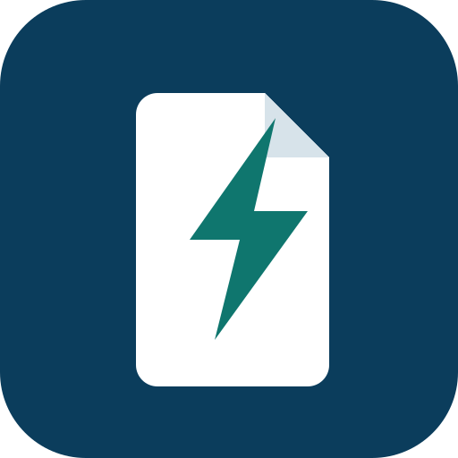

# Office Express

Navegador ligero para Google Workspace: Documentos, Hojas de cálculo,
Presentaciones, Drive, Gmail, Calendar, Meet, Formularios y Keep en un
solo lugar, pensado para equipos sencillos y pantallas táctiles.



## Qué es

**App de escritorio (Electron/Chromium):** una ventana con mosaicos
grandes estilo tablet. Cada app de Google se abre en su propia pestaña
dentro de la app, con atrás / adelante / recargar y sesión persistente:
inicias sesión con tu cuenta de Google una vez y no se pierde al cerrar.

**Versión web (`web/`):** el mismo lanzador de mosaicos como sitio
estático para Vercel. Google no permite incrustar sus apps en un iframe
(`X-Frame-Options`), así que en la web cada mosaico abre su app en una
pestaña nueva del navegador. La app de escritorio sí las tiene dentro.

La app no tiene login propio y no guarda contraseñas: la sesión vive en
el perfil de Electron de cada usuario, en su propio equipo.

## Instalar (Windows y Mac)

1. Descarga el instalador de la última versión (Releases):
   - Windows: `Office Express Setup 1.1.0.exe` — instalador NSIS.
   - macOS: `Office Express-1.1.0.dmg` — arrastra la app a Aplicaciones.
2. Abre Office Express, toca una app e inicia sesión con tu cuenta
   de Google dentro de la app. Listo.

## Inicio de sesión con Google

Google bloquea el inicio de sesión desde navegadores embebidos ("This
browser or app may not be secure", error 403 `disallowed_useragent`), y
además rechaza un User-Agent de Chrome "pelado": compara la identidad de
la petición con la del JavaScript de la página, y en Electron
`window.chrome` es un objeto vacío y no hay client hints. Por eso la app
presenta la identidad completa y consistente del Chromium que ya trae,
en tres capas (`main.js` + `google-identity-preload.js`):

1. **User-Agent de Chrome de escritorio** con versión reducida
   (`Chrome/<mayor>.0.0.0`), sin los tokens `Electron` ni de la app,
   en cada pestaña (BrowserView).
2. **Client hints** (`Sec-CH-UA`, `Sec-CH-UA-Mobile`, `Sec-CH-UA-Platform`)
   en las peticiones a Google.
3. **Identidad JavaScript**: `navigator.userAgentData` (marcas de Chrome)
   y `window.chrome` (`app`, `csi`, `loadTimes`, `runtime`) inyectados al
   inicio del documento, solo en páginas de Google.

Verificado con la prueba de humo (`npm start` con `--smoke-test`): la
página de sign-in de Google carga el formulario y Google sirve el flujo
estándar (`GlifWebSignIn`), no el flujo degradado que servía antes
(`WebLiteSignIn`) ni el error de navegador no seguro.

**Qué puede fallar todavía (honesto):**
- La detección de Google es un objetivo móvil: puede endurecerla en el
  futuro y volver a pedir verificación. Si eso pasa, hay que actualizar
  la identidad a la versión de Chromium que traiga Electron entonces.
- La primera vez, Google puede pedir verificación adicional (código,
  confirmación en el teléfono) como con cualquier navegador nuevo.
- **No se pudo probar un login completo**: hace falta una cuenta real de
  Google, y la app no guarda ni pide contraseñas. Esa prueba queda
  pendiente de hacer con la cuenta de cada usuario.
- Si Google llegara a bloquear de nuevo el sign-in dentro de la app, la
  alternativa es iniciar sesión en el navegador real (Chrome) — pero la
  sesión de Chrome no se puede pasar a la app, así que habría que usar
  la versión web de Office Express en ese caso.

> **Aviso de instalador sin firmar:** los instaladores de la primera
> versión no están firmados con certificado. Windows (SmartScreen) y
> macOS (Gatekeeper) pueden mostrar una advertencia al abrirlos; hay que
> elegir "Ejecutar de todos modos" / "Abrir". Firmar los instaladores es
> un paso aparte que requiere certificados (Apple Developer y certificado
> de firma de código para Windows).

## Desarrollo

```bash
npm install
npm start
```

## Generar los instaladores

```bash
npm run dist        # instalador de la plataforma actual
npm run dist:win    # instalador Windows x64 (NSIS)
npm run dist:win:dir # carpeta Windows sin instalador, ejecutable en Windows
npm run dist:mac    # macOS universal (Apple Silicon e Intel), DMG
npm run dist:mac:arm64 # DMG solo Apple Silicon
npm run dist:mac:x64   # DMG solo Intel
npm run dist:all    # genera macOS y luego Windows
```

Los artefactos quedan en `dist/`. El DMG se genera desde macOS. Para crear el instalador Windows desde macOS se necesita Wine; si no está disponible, `dist:win:dir` produce `dist/win-unpacked/Office Express.exe` para copiar a una PC Windows. Para publicar un instalador, usa Windows o un runner Windows de GitHub Actions.

La salida macOS universal puede tardar y ocupar más espacio que una salida de una sola arquitectura. Para distribuir la app fuera de pruebas, configura un certificado **Developer ID Application** en el llavero y notarización de Apple; sin ellos el DMG se genera sin firma y macOS puede advertir al abrirlo. Los artefactos generados en `dist/` están excluidos de Git.

El catálogo de respaldo vive en [`web/apps.js`](web/apps.js) y el catálogo remoto en [`web/apps.json`](web/apps.json). Para agregar una app o sección, añade el mismo objeto a ambos archivos con `id`, `section`, `name`, `desc`, `url`, `color` e `icon`. Al publicar `apps.json` en la rama `main`, las apps de escritorio actualizan la lista al conectarse; sin internet conservan el catálogo empacado. La web usa el JSON de su mismo origen. Los iconos disponibles se enumeran al inicio de `apps.js`. Los sitios agregados se abren como pestañas; para mantener sus ventanas emergentes dentro de Electron, agrega su dominio permitido en `main.js`.

En el lanzador de escritorio abre **Gestionar apps** para agregar, editar o eliminar apps y asignarlas a secciones. Los cambios se guardan localmente en ese equipo. **Descargar catálogo** crea `apps.json`; para distribuir los cambios a todos, reemplaza `web/apps.json` en el repo con ese archivo y publica la rama `main`. **Usar catálogo publicado** descarta los cambios locales y vuelve a cargar el catálogo remoto. Agregar dominios externos a la lista del catálogo no les concede acceso automático dentro de la ventana Electron: los nuevos dominios se abren en el navegador externo hasta agregarlos a `allowedInApp` en `main.js`.

El indicador de conexión permite reintentar con **Actualizar apps** y se vuelve a comprobar cuando regresa la conexión. El preloader mantiene la marca y la barra de progreso visibles durante 4 segundos.

En la app de escritorio puedes escribir una URL o una búsqueda en la barra superior y presionar **Enter** para navegar en la pestaña activa.

Créditos de la app: **David Morales · [www.routicket.com](https://www.routicket.com) · +52 984 266 5680 · xupplier@gmail.com · contacto@routicket.com**.

## Versión web (Vercel)

La carpeta `web/` es un sitio estático listo para desplegar:

- **Desde el panel de Vercel:** importa el repo, pon el directorio raíz
  (`Root Directory`) en `web` y despliega. No necesita comando de build.
- **Desde la terminal:** `cd web && vercel` (o `vercel --prod`).

No se despliega solo con subir el repo: el despliegue se hace aparte
cuando se decida.

## Estructura

```
main.js                    Proceso principal (ventana, pestañas, BrowserView, identidad Chrome)
preload.js                 Puente seguro renderer <-> main
google-identity-preload.js Identidad Chrome en las pestañas (userAgentData + window.chrome)
renderer/                  Home táctil + pestañas (index.html, styles.css, renderer.js)
web/               Versión web estática (index.html, styles.css, app.js, vercel.json)
web/apps.js        Catálogo compartido de apps y secciones para escritorio y web
assets/icon.png    Icono raster de la app
assets/icon.ico    Icono del instalador Windows
assets/icon.svg    Logo en vector
```

## Licencia

MIT.
